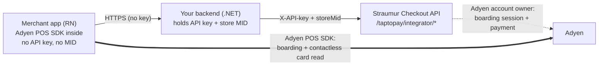

# Straumur Tap to Pay — integrator sample

A reference implementation of the **Straumur Tap to Pay integrator flow**: take contactless
card payments on a merchant's own phone (Android SoftPOS), from an app you build, using your
Straumur API key.

This sample shows the **correct, secure shape** of that integration:



Two separate paths: the **REST path** (app → your backend → Straumur) sets up the session and
pre-creates each payment, while the **Adyen SDK inside the app talks to Adyen directly** to
board the device and read the card. Straumur is the Adyen account owner, so it brokers the
boarding session and the payment with Adyen — your app never sends card data anywhere itself.

> **Why the split?** Your Straumur API key is a bearer credential for your whole account. It
> must **never** ship inside a mobile app, where it can be extracted from the binary or
> intercepted. So the app talks only to *your* backend, and your backend — server-side, where
> the key is safe — adds the `X-API-key` header and the store MID and calls Straumur. This
> sample is built that way on purpose.

## What's in here

| Folder | What it is | Stack |
|---|---|---|
| [`server/`](./server) | The integrator's backend. Holds the API key + MID and brokers the two Tap to Pay calls to Straumur. | ASP.NET Core (.NET 10) minimal API |
| [`app/`](./app) | The merchant-facing app. Talks only to `server/`, then hands the returned data to the Adyen SDK for the contactless read. | Expo · React Native · TypeScript |

## The flow

1. **Session** — the app gets a `setupToken` from the Adyen SDK and POSTs it to your
   `server/`, which calls Straumur `…/integrator/sessions`. Straumur lazily provisions the
   device (keyed on its POIID within your store) and returns `sdkData` to board the SDK.
2. **Payment** — for a charge, the app POSTs `{ poiId, amount, currency }` to your `server/`,
   which calls Straumur `…/integrator/payment`. Straumur pre-creates the payment and returns a
   ready-to-run Adyen `SaleToPOIRequest`.
3. **Read** — the app hands that request to the Adyen SDK, which performs the contactless read
   on the device.
4. **Result** — the authorization outcome arrives on your **payment webhook**, correlated by
   the `reference` from step 2 (not in the HTTP response — the card is read afterwards).

## Getting started

Run the backend, then the app:

```bash
# 1. backend — see server/README.md for configuring your API key + MID
cd server
dotnet run          # http://localhost:5080

# 2. app — see app/README.md
cd ../app
npm install
npx expo run:android
```

Each folder has its own README with the details. Taking a payment needs an Adyen account
enabled for Tap to Pay, an SDK-download key (in `~/.gradle/gradle.properties`), and a physical
Android 12+ NFC device with a test card — see `app/README.md`. The native Adyen module requires
a dev build (`expo run:android`), not Expo Go.

## Not included (intentionally)

This is a starting point, not a drop-in production integration. Before going live you would add:
app-to-server authentication and MID resolution per authenticated merchant (rather than the
hardcoded key + MID in the sample backend). Each is called out where it applies in the code and
the per-folder READMEs.

## License

[MIT](./LICENSE) © Straumur greiðslumiðlun hf.
