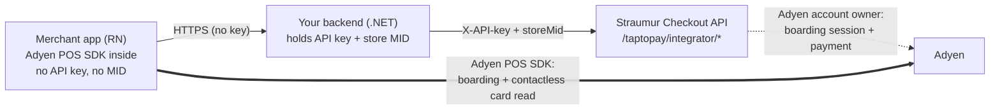

# Straumur Tap to Pay — integrator sample

A reference implementation of the **Straumur Tap to Pay integrator flow**: take contactless
card payments on a merchant's own phone (Android SoftPOS), from an app you build, using your
Straumur API key.

This sample shows the **correct, secure shape** of that integration:



Two separate paths: the **REST path** (app → your backend → Straumur) sets up the session and
pre-creates each payment, while the **Adyen SDK inside the app talks to Adyen directly** to
board the device and read the card. Straumur is the Adyen account owner, so it brokers the
boarding session and the payment with Adyen — your app never sends card data anywhere itself.

> **Why the split?** Your Straumur API key is a bearer credential for your whole account. It
> must **never** ship inside a mobile app, where it can be extracted from the binary or
> intercepted. So the app talks only to *your* backend, and your backend — server-side, where
> the key is safe — adds the `X-API-key` header and the store MID and calls Straumur. This
> sample is built that way on purpose.

## What's in here

| Folder | What it is | Stack |
|---|---|---|
| [`server/`](./server) | The integrator's backend — **shared by every app below**. Holds the API key + MID and brokers the two Tap to Pay calls to Straumur. | ASP.NET Core (.NET 10) minimal API |
| [`app/android/`](./app/android) | Merchant app, **native**. The most direct integration — start here. | Kotlin · Compose |
| [`app/react-native/`](./app/react-native) | Merchant app, cross-platform, over a local Expo module wrapping the SDK. | Expo · React Native · TypeScript |

Both apps are **one file** each and do the same thing; pick whichever matches your stack. They
share the same `server/`, so you only configure your API key once.

> **On SDK support:** Adyen ships the Tap to Pay SDK for **native Android only** — there are no
> official React Native or Flutter wrappers for it. (The `@adyen/react-native` and
> `adyen_checkout` packages are for *online* checkout, a different product.) So `app/android/`
> talks to the SDK directly, while `app/react-native/` includes a small Kotlin bridge we wrote
> in `modules/straumur-tap-to-pay/`. A Flutter app would need the equivalent bridge.

## The flow

1. **Session** — the app gets a `setupToken` from the Adyen SDK and POSTs it to your
   `server/`, which calls Straumur `…/integrator/sessions`. Straumur lazily provisions the
   device (keyed on its POIID within your store) and returns `sdkData` to board the SDK.
2. **Payment** — for a charge, the app POSTs `{ poiId, amount, currency }` (amount in minor
   units, so 1000 ISK is `100000`) to your `server/`,
   which calls Straumur `…/integrator/payment`. Straumur pre-creates the payment and returns a
   ready-to-run Adyen `SaleToPOIRequest`.
3. **Read** — the app hands that request to the Adyen SDK, which performs the contactless read
   on the device.
4. **Result** — the authorization outcome arrives on your **payment webhook**, correlated by
   the `reference` from step 2 (not in the HTTP response — the card is read afterwards).

## What you need from Straumur

You do **not** need an Adyen account — Straumur is the Adyen account owner. Request these before
you start:

| | Used by | Where it goes |
|---|---|---|
| **Straumur API key** | `server/` | `server/secrets.json` (gitignored) |
| **Store MID** | `server/` | `server/secrets.json` (gitignored) |
| **Adyen SDK-download key** | the app build | `~/.gradle/gradle.properties` as `adyenSdkApiKey` |

The SDK-download key is what lets Gradle pull the Adyen POS Mobile SDK from Adyen's credentialed
maven repo. None of these belong in source control, and none of them ship inside the app.

You will also need a physical **Android 12+ device with NFC** and a **test card**.

## Getting started

Run the backend, then one of the apps:

```bash
# 1. backend — see server/README.md for configuring your API key + MID
cd server
dotnet run                      # http://localhost:5080

# tunnel it to the phone over USB
adb reverse tcp:5080 tcp:5080

# 2a. native Android
cd ../app/android && ./gradlew installDebug

# 2b. …or React Native
cd ../app/react-native && npm install && npx expo run:android
```

Each folder has its own README with the details. The React Native app needs a dev build
(`expo run:android`), not Expo Go — the Adyen SDK is a native module.

## Not included (intentionally)

This is a starting point, not a drop-in production integration. Before going live you would add:
app-to-server authentication and MID resolution per authenticated merchant (rather than the
hardcoded key + MID in the sample backend). Each is called out where it applies in the code and
the per-folder READMEs.

## License

[MIT](./LICENSE) © Straumur greiðslumiðlun hf.
